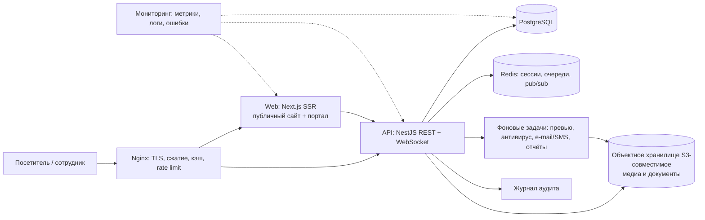

# Архитектура production-версии

> **⚠️ Частично устарел (этап 0).** Выбор стека, Redis, WebSocket и отдельный API заменены решением в [STACK_DECISION.md](STACK_DECISION.md) (Django, монолит, без Redis/WebSocket на старте). Формулировка о локализации данных (§6.1) уточнена в [LEGAL_AND_DATA_CHECKLIST.md](LEGAL_AND_DATA_CHECKLIST.md). Актуальные разделы: §1 (аудит), §4, §5, §6.2–6.4, §7. Порядок действий — [STAGE_0_PLAN.md](STAGE_0_PLAN.md) §10.

**Проект:** Mirzacho‘l tumani Xalq ta’limi bo‘limi · **Статус документа:** черновик для согласования · **База аудита:** ветка `claude/charming-feynman-3h7nwq`, коммит `ec3231b`

Связанные документы: [DATA_MODEL.md](DATA_MODEL.md) · [ROLES_PERMISSIONS.md](ROLES_PERMISSIONS.md) · [ROADMAP.md](ROADMAP.md)

> Всё ниже — рекомендации, а не принятые решения. Пункты, зависящие от вашего ответа, собраны в разделе 9.
> Юридические и ценовые утверждения помечены **[проверить]**: я не могу подтвердить их из этой среды.

---

## 1. Что есть сейчас (аудит HEAD)

| Параметр | Факт |
|---|---|
| Тип | Статический сайт, HTML + CSS + JS, без сборки и зависимостей |
| Страницы | 24: 8 публичных (`index`, `news`, `news-detail`, `ustozlar`, `ustoz`, `media`, `tashkilot`, `hujjatlar`), `login`, 15 страниц портала в `app/` |
| Код | `styles.css` 316 строк · `app.js` 230 · `pages.js` 70 · `data.js` 68 |
| Дизайн-система | CSS-переменные (цвета, радиусы, тени, отступы, размеры) — **готовы к переиспользованию как есть** |
| Общий каркас | Публичная шапка/подвал и портальный сайдбар/топбар собираются JS из одного места (`app.js`) |
| Данные | Заглушки в `data.js`; форма данных уже близка к будущему ответу API |
| Авторизация | Имитация: любой логин и пароль, кроме «xato», ведут в портал. Защиты нет |
| i18n | Заготовка: словарь `t(key)`, `data-i18n`; заполнен только uz |
| Имитационные действия | 15 кнопок с пометкой «Maket» (загрузка, сохранение, экспорт, отметка прихода и др.) — это готовый список функций для бэклога |
| Внешние зависимости | Google Fonts на всех 24 страницах (для production — убрать, см. 6.4) |

**Вывод.** Дизайн и структура экранов готовы. Весь «серверный» слой (данные, пользователи, права, файлы, реальное время) отсутствует, и его нужно строить с нуля. Текущий JS — прототип: его логика (сборка шапки, фильтры, вкладки) переписывается на компоненты, а не переносится.

---

## 2. Принципы

1. **Модульный монолит, а не микросервисы.** Один отдел района — десятки пользователей, а не миллионы. Микросервисы добавили бы расходы на эксплуатацию без выгоды.
2. **Один язык (TypeScript) на фронте и бэке** — проще найти и заменить разработчиков, общие типы между клиентом и API.
3. **Публичный сайт и портал — разные режимы одного приложения:** публичные страницы рендерятся на сервере (SEO, скорость), портал — за авторизацией.
4. **Безопасность по умолчанию:** персональные данные сотрудников и фото детей — зона повышенного риска.
5. **Размещение данных в Узбекистане** — закладывается с первого дня **[проверить требования к локализации персональных данных у юриста]**.
6. **Двигаться поэтапно:** публичный сайт запускается раньше портала.

---

## 3. Рекомендуемая архитектура

### 3.1 Frontend

| Решение | Выбор | Почему |
|---|---|---|
| Фреймворк | **Next.js (React, TypeScript)**, App Router, два раздела маршрутов: `(public)` и `(portal)` | SSR для SEO и скорости публичной части; один репозиторий |
| Стили | Текущие CSS-переменные как глобальные токены + CSS Modules на компонент | Не переписывать дизайн; не тащить Tailwind ради отдельных страниц |
| Иконки | Собственный набор SVG (сейчас в `app.js`) → пакет иконок | Уже согласован визуально |
| Данные | Клиент по OpenAPI (генерируется из бэкенда), кэш запросов TanStack Query | Типобезопасность |
| Формы | React Hook Form + Zod | Валидация одна для клиента и сервера |
| i18n | `next-intl` или `i18next`; ключи в формате, уже заложенном в `t(key)` (`nav.news`, `pub.docs`) | Переход без переделки интерфейса: uz, ru, en |
| Шрифт | Inter, **хостится у нас** | Нет внешних запросов, нет утечки IP посетителей |
| Доступность | WCAG 2.1 AA: фокус, контраст, клавиатура | Государственный сайт; часть уже сделана (focus-visible, aria) |

**Что переиспользуется напрямую:** токены цветов и размеров, все компоненты (кнопки, карточки, таблицы, бейджи, вкладки, модальные окна, дропдауны, пустые состояния), сетки, мобильные раскладки, структура страниц.
**Что переписывается:** `app.js` (шапка/подвал/сайдбар → React-компоненты), `pages.js` (фильтры → запросы к API с пагинацией), `data.js` (заменяется API).

### 3.2 Backend

| Решение | Выбор |
|---|---|
| Фреймворк | **NestJS (TypeScript)**, модульная структура, REST + OpenAPI; WebSocket для чата и уведомлений |
| ORM / миграции | Prisma или Drizzle + версионируемые миграции |
| Валидация | Zod/class-validator на каждом входе |
| Фоновые задачи | BullMQ (на Redis): превью изображений, антивирусная проверка, письма и SMS, отчёты |
| Поиск | Сначала полнотекстовый PostgreSQL; отдельный поисковый движок — только если не хватит |
| Файлы | S3-совместимое хранилище (MinIO на своём сервере); загрузка по подписанным ссылкам, проверка типа и размера, антивирус |

Модули: `auth`, `users`, `org` (подразделения, должности, учреждения), `news`, `teachers`, `media`, `documents`, `tasks`, `attendance`, `chat`, `notifications`, `reports`, `audit`, `settings`.

**Альтернатива (если нет JS-разработчиков):** Django + Django REST Framework + HTMX/React. Плюсы: готовая админка, права и миграции «из коробки», дешевле для небольшой команды. Минусы: два языка в проекте, чуть больше работы на интерактивных частях. Модель данных и план от этого не меняются.

### 3.3 База данных

**PostgreSQL 16.** Реляционная модель, транзакции, полнотекстовый поиск, `row-level` ограничения при необходимости. Redis — только для сессий, очередей и pub/sub, данные там не хранятся постоянно. Подробная модель — в [DATA_MODEL.md](DATA_MODEL.md).

### 3.4 Авторизация

| Вопрос | Решение |
|---|---|
| Сессии | Серверные сессии в Redis, cookie `HttpOnly; Secure; SameSite=Lax`. **Не** JWT в `localStorage` (уязвим к XSS) |
| Пароли | Argon2id, политика длины, проверка на утёкшие пароли |
| Защита входа | Ограничение попыток, временная блокировка, единые сообщения об ошибках, уведомление о новом входе |
| 2FA | TOTP обязательна для администраторов, включаема для остальных |
| Восстановление | Одноразовая ссылка на e-mail (SMS — через местного оператора) **[выбрать провайдера]** |
| Единый вход | OneID (государственная идентификация) как опция второго этапа **[проверить доступность и условия подключения]** |
| Права | RBAC + области видимости (своё / подразделение / всё). Матрица — в [ROLES_PERMISSIONS.md](ROLES_PERMISSIONS.md) |
| Аудит | Журнал: входы, изменения прав, доступ к персональным данным, выгрузки, удаления |
| CSRF/XSS | CSRF-токены, строгая CSP, экранирование, очистка HTML из редактора новостей |

Текущая имитация входа (`#loginForm` в `app.js`) удаляется целиком; страница `login.html` остаётся как дизайн.

### 3.5 Инфраструктура

| Слой | Решение |
|---|---|
| Размещение | Сервер/облако в дата-центре в Узбекистане **[выбрать провайдера, запросить КП]** |
| Развёртывание | Docker Compose на старте (проще эксплуатировать); Kubernetes — избыточен |
| Окружения | `dev`, `staging`, `production`, отдельные базы и ключи |
| CI/CD | GitHub Actions: линтер, типы, тесты, сборка образов, деплой на staging автоматически, на production — по кнопке |
| Резервные копии | БД — ежедневно + журнал WAL; файлы — ежедневно; копия хранится в другом месте; **ежеквартально проверка восстановления**. Целевые RPO ≤ 24 ч, RTO ≤ 4 ч (предложение) |
| Мониторинг | Метрики и дашборды, централизованные логи, отслеживание ошибок (self-hosted), проверка доступности |
| Секреты | Не в репозитории; переменные окружения/хранилище секретов |
| Обновления | Регулярное обновление зависимостей и образов, автоматическая проверка уязвимостей |

---

## 4. Соответствие текущих экранов и серверных модулей

| Страница (HEAD) | Модуль и ключевые операции | Статус макета |
|---|---|---|
| `index`, `news`, `news-detail` | `news`: список, фильтр, поиск, карточка; публикация | данные — заглушки |
| `ustozlar`, `ustoz` | `teachers`: список, профиль; **публикация только с согласия педагога** | заглушки |
| `media` (публ. и портал) | `media`: альбомы, загрузка, превью, видео | загрузка — «Maket» |
| `tashkilot` (публ. и портал) | `org`: структура, подразделения, учреждения | заглушки |
| `hujjatlar` (публ.) / `app/hujjatlar` | `documents`: категории, версии, скачивание, права | скачивание — «Maket» |
| `login` | `auth`: вход, 2FA, восстановление | имитация |
| `dashboard` | агрегаты из `tasks`, `news`, `notifications` | заглушки |
| `xodimlar` | `users`/`employees`: CRUD, фильтры, профиль, права | добавление — «Maket» |
| `yangiliklar` | `news`: редактор, статусы (черновик/опубликовано) | сохранение — «Maket» |
| `topshiriqlar` | `tasks`: создание, назначение, статусы, комментарии, вложения, история | создание — «Maket» |
| `kirish-chiqish`, `geolokatsiya` | `attendance`: отметка прихода/ухода, геозоны, отчёты | отметка — «Maket» |
| `yutuqlar`, `sertifikatlar` | `achievements`, `certificates`: файлы, сроки действия | заглушки |
| `chat` | `chat`: диалоги, сообщения, непрочитанные (WebSocket) | в памяти страницы |
| `bildirishnomalar` | `notifications`: лента, прочитано/нет, привязка к объектам | заглушки |
| `hisobotlar` | `reports`: агрегаты, экспорт | заглушки |
| `admin` | `settings`, управление справочниками, журнал аудита | заглушки |

---

## 5. Нефункциональные требования (предложение)

| Область | Целевое значение |
|---|---|
| Доступность сайта | ≥ 99,5 % в месяц (вне плановых работ) |
| Скорость | LCP публичных страниц ≤ 2,5 с на среднем мобильном; бюджет JS на страницу ≤ 200 КБ |
| Нагрузка | Расчёт на сотни одновременных посетителей и десятки сотрудников; нагрузочное тестирование перед запуском |
| SEO | SSR, `sitemap.xml`, OpenGraph, чистые адреса, семантическая разметка |
| Безопасность | Тест на проникновение перед запуском; соответствие требованиям кибербезопасности для государственных ресурсов **[проверить перечень требований и порядок аудита]** |
| Доступность (a11y) | WCAG 2.1 AA |
| Языки | uz (латиница) при запуске; ru и en — по готовности переводов |

---

## 6. Особые вопросы

### 6.1 Персональные данные
Сотрудники (ФИО, телефон, e-mail, документы, геолокация), педагоги, дети на фото. Нужны: перечень обрабатываемых данных, цели, сроки хранения, порядок согласий, права доступа, журнал доступа. **[проверить с юристом: локализация данных, регистрация баз, требования к согласию]**.

### 6.2 Геолокация сотрудников
Самая чувствительная функция. Рекомендации: геозона вместо постоянного трекинга, координаты записываются **только в момент отметки**, понятное уведомление и согласие сотрудника, ограниченный срок хранения, доступ только у HR/руководителя. **[проверить с юристом: допустимость по трудовому законодательству]**.

### 6.3 Изображения детей и педагогов
Публикация фото — только при подтверждённом согласии (для детей — родителей/законных представителей). В модели данных — поле `consent_*` у медиа и профилей; без согласия объект не публикуется.

### 6.4 Что убрать при переходе на production
- Google Fonts → собственный хостинг шрифта.
- `.nojekyll` и подкаталог `/Project_Talim/` — относятся только к GitHub Pages.
- Имитацию входа и все 15 кнопок «Maket» заменить реальными функциями.
- Заглушки «Namuna …», «00» — заменить данными.
- Добавить: политику конфиденциальности, согласие на cookie (если будет аналитика), страницу ошибок 404/500, `robots.txt`.

---

## 7. Тестирование

| Уровень | Что |
|---|---|
| Модульные | Бизнес-правила, права доступа (обязательно: тест на каждую роль × ресурс) |
| Интеграционные | API + БД на тестовой базе |
| E2E | Ключевые сценарии (вход, публикация новости, постановка и закрытие задания, отметка прихода) в Playwright |
| Визуальные | Скриншот-тесты на 360 / 390 / 768 / 1024 / 1440 px — перенос текущих проверок адаптивности в автоматические |
| Безопасность | Автосканы зависимостей и образов, ручной тест на проникновение |
| Нагрузка | Сценарии для публичной части и API |

---

## 8. Что не входит в первую версию (предложение)

Мобильное приложение, интеграции с внешними государственными системами, файловый предпросмотр документов в браузере, голосовые/видеозвонки в чате, расширенная аналитика. Ответ по каждому пункту — в разделе 9.

---

## 9. Решения, которые нужны от вас

| № | Вопрос | Влияет на |
|---|---|---|
| 1 | Команда: есть ли свои разработчики (какой стек) или нужен подрядчик? | Выбор стека (раздел 3.2), сроки, расходы |
| 2 | Где размещать: свой сервер, облако местного провайдера, государственный ЦОД? | Инфраструктура, цена, безопасность |
| 3 | Есть ли существующие системы и данные для переноса (списки сотрудников, школ, архив новостей)? | Этап миграции |
| 4 | Нужен ли вход через OneID? | Срок и интеграция |
| 5 | Нужен ли чат на запуске или можно позже? | Объём работ (чат — самый затратный модуль) |
| 6 | Нужна ли геолокация и в каком виде? | Юридическая проверка, объём |
| 7 | Языки при запуске: только uz или uz + ru + en? | Перевод и контент |
| 8 | Кто будет вести контент (новости, фото, документы) и кто утверждает публикации? | Роли и процесс публикации |
| 9 | Домен (.uz / иной) и требования к государственному ресурсу | Запуск |
| 10 | Бюджет и желаемая дата запуска | План и объём первой версии |
