# Модель данных

База: PostgreSQL. Это логическая модель для согласования, не готовая схема. Имена таблиц — на английском, интерфейс остаётся на узбекском.
Общие поля у всех таблиц: `id` (UUID), `created_at`, `updated_at`; у публикуемого контента и данных сотрудников — также `deleted_at` (мягкое удаление) и `created_by`.

Форма данных в текущем `assets/js/data.js` близка к этой модели: `news`, `teachers`, `schools`, `depts`, `photos`, `videos`, `docs`, `notifs`.

## 1. Связи (упрощённо)

```mermaid
erDiagram
  USERS ||--o| EMPLOYEES : "профиль"
  USERS }o--o{ ROLES : "user_roles"
  ROLES }o--o{ PERMISSIONS : "role_permissions"
  DEPARTMENTS ||--o{ EMPLOYEES : "работают"
  POSITIONS ||--o{ EMPLOYEES : "занимают"
  INSTITUTIONS ||--o{ TEACHERS : "преподают"
  EMPLOYEES ||--o{ ACHIEVEMENTS : "получают"
  EMPLOYEES ||--o{ CERTIFICATES : "получают"
  TEACHERS ||--o{ ACHIEVEMENTS : "получают"
  USERS ||--o{ NEWS : "автор"
  NEWS_CATEGORIES ||--o{ NEWS : "категория"
  NEWS }o--o| MEDIA_ASSETS : "обложка"
  ALBUMS ||--o{ MEDIA_ASSETS : "содержит"
  DOCUMENT_CATEGORIES ||--o{ DOCUMENTS : "категория"
  DOCUMENTS ||--o{ DOCUMENT_VERSIONS : "версии"
  USERS ||--o{ TASKS : "автор"
  TASKS ||--o{ TASK_ASSIGNEES : "исполнители"
  USERS ||--o{ TASK_ASSIGNEES : "назначены"
  TASKS ||--o{ TASK_COMMENTS : "обсуждение"
  TASKS ||--o{ TASK_EVENTS : "история"
  TASKS ||--o{ TASK_ATTACHMENTS : "вложения"
  USERS ||--o{ ATTENDANCE_RECORDS : "отметки"
  WORK_ZONES ||--o{ ATTENDANCE_RECORDS : "зона"
  CONVERSATIONS ||--o{ CONVERSATION_MEMBERS : "участники"
  CONVERSATIONS ||--o{ MESSAGES : "сообщения"
  USERS ||--o{ NOTIFICATIONS : "получают"
  USERS ||--o{ AUDIT_LOG : "действия"
```

## 2. Таблицы

### 2.1 Доступ и пользователи
| Таблица | Ключевые поля | Примечания |
|---|---|---|
| `users` | `login`, `email`, `password_hash`, `status` (active/blocked/invited), `last_login_at`, `totp_secret` (шифр.), `locale` | Только учётная запись. Данные человека — в `employees` |
| `roles` | `code`, `name` | См. [ROLES_PERMISSIONS.md](ROLES_PERMISSIONS.md) |
| `permissions` | `code` (`news.publish`, `tasks.create` …), `description` | Справочник действий |
| `role_permissions`, `user_roles` | связи; в `user_roles` — `scope` (own/department/all), `department_id` | Область действия роли |
| `sessions` | `user_id`, `ip`, `user_agent`, `expires_at` | Хранятся в Redis; здесь — журнал для отзыва и просмотра активных входов |
| `audit_log` | `user_id`, `action`, `object_type`, `object_id`, `ip`, `meta` (JSON), `at` | Только добавление, без правки и удаления |

### 2.2 Организация
| Таблица | Ключевые поля |
|---|---|
| `departments` | `name`, `parent_id`, `head_employee_id`, `description` |
| `positions` | `name` |
| `institutions` (школы, МТТ, ижод и др.) | `name`, `type`, `head_name`, `status`, `address`, `phone`, `email` — публичные контакты только подтверждённые |
| `employees` | `user_id`, `last_name`, `first_name`, `middle_name`, `department_id`, `position_id`, `phone`, `email`, `hired_at`, `status`, `photo_asset_id`, `show_phone_to` (visibility) |
| `teachers` | `institution_id`, `employee_id` (необязательно), `full_name`, `subject`, `role`, `bio`, `photo_asset_id`, `public_consent_at`, `published` |
| `achievements` | `owner_type` (employee/teacher), `owner_id`, `title`, `year`, `category`, `asset_id`, `published` |
| `certificates` | `owner_id`, `title`, `issued_at`, `expires_at`, `file_asset_id`, `verified` |

Персональные поля `employees` (телефон, e-mail, дата приёма) отдаются API только при праве `employees.read_contacts` и в нужной области; в журнал аудита пишется чтение карточки.

### 2.3 Контент
| Таблица | Ключевые поля |
|---|---|
| `news_categories` | `name` (uz/ru/en) |
| `news` | `title`, `slug`, `excerpt`, `body` (очищенный HTML), `category_id`, `cover_asset_id`, `status` (draft/review/published/archived), `publish_at`, `author_id`, `approved_by`, `locale` |
| `albums` | `title`, `published`, `cover_asset_id` |
| `media_assets` | `kind` (image/video/file), `storage_key`, `mime`, `size`, `width`, `height`, `duration`, `album_id`, `alt_text`, `caption`, `consent_confirmed_at`, `scan_status` (pending/clean/infected), `uploaded_by` |
| `document_categories` | `name`, `parent_id` |
| `documents` | `title`, `category_id`, `kind`, `visibility` (public/staff/department/restricted), `status`, `current_version_id`, `author_id` |
| `document_versions` | `document_id`, `version`, `asset_id`, `note` |

Переводы: либо колонки `title_uz/ru/en`, либо таблица `translations(object_type, object_id, field, locale, value)` — выбираем на этапе согласования языков (вопрос 7).

### 2.4 Работа
| Таблица | Ключевые поля |
|---|---|
| `tasks` | `title`, `description`, `author_id`, `priority` (low/mid/high), `status` (new/in_progress/done/overdue), `due_at`, `completed_at`, `related_object` |
| `task_assignees` | `task_id`, `user_id`, `status`, `done_at` |
| `task_comments`, `task_attachments` | автор, текст / файл |
| `task_events` | `task_id`, `type` (created/status/assignee/due), `from`, `to`, `by`, `at` — основа для «Истории изменений» |
| `work_zones` | `name`, `center_lat`, `center_lng`, `radius_m`, `active` |
| `attendance_records` | `user_id`, `type` (in/out), `at`, `zone_id`, `lat`, `lng` (**только в момент отметки**), `status` (on_time/late/outside_zone), `consent_version` |
| `conversations` | `type` (direct/group), `title` |
| `conversation_members` | `conversation_id`, `user_id`, `last_read_message_id` |
| `messages` | `conversation_id`, `sender_id`, `body`, `attachment_asset_id`, `sent_at`, `edited_at`, `deleted_at` |
| `notifications` | `user_id`, `kind` (task/news/document/system), `title`, `body`, `object_type`, `object_id`, `read_at` |

### 2.5 Служебные
`settings` (ключ–значение: контакты, тексты подвала, интервалы), `translations`, `email_outbox`/`sms_outbox` (очередь), `report_exports` (кто, когда, какие фильтры).

## 3. Правила целостности и хранения

- Удаление пользователей и сотрудников — мягкое; безвозвратное удаление — по регламенту сроков хранения **[определить с юристом]**.
- `audit_log` не редактируется; выдача только администраторам.
- Просроченность заданий считается по `due_at` и статусу, а не хранится отдельно как вручную меняемое значение.
- Публичные запросы видят только записи с `published = true` и подтверждённым согласием там, где оно требуется.
- Индексы: по `news(status, publish_at)`, `tasks(status, due_at)`, `tasks_assignees(user_id)`, `notifications(user_id, read_at)`, `attendance_records(user_id, at)`, полнотекстовые — по `news`, `documents`, `employees`.
- Все файлы — в хранилище объектов; в БД только ключи и метаданные.
